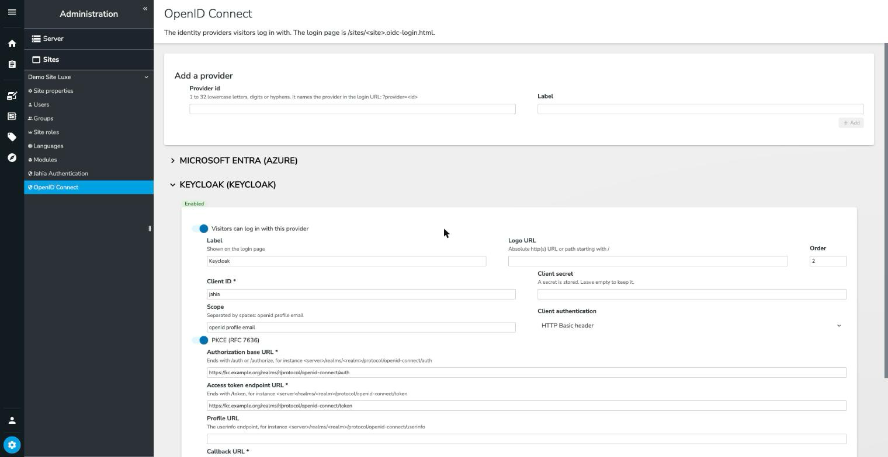
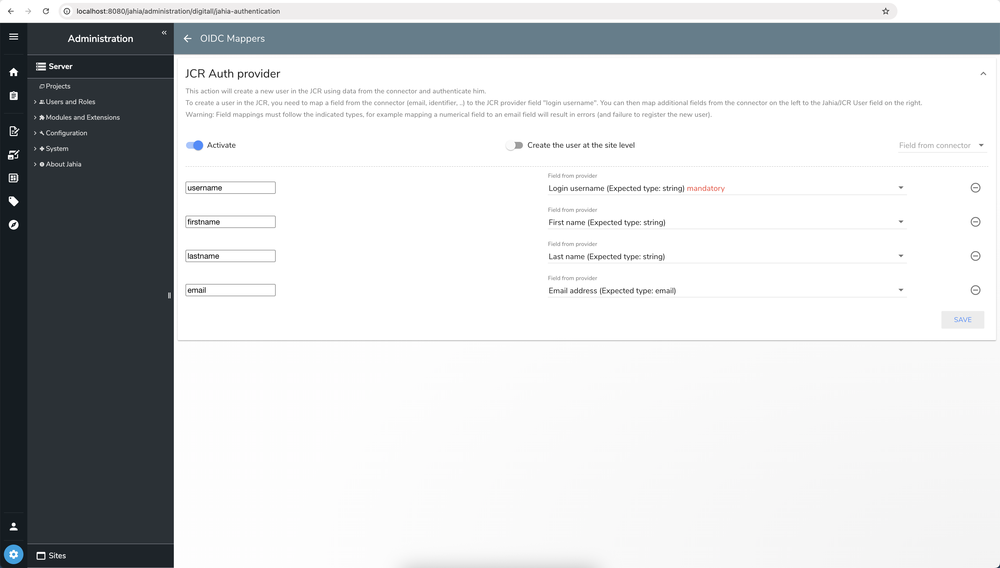

# jahia-oauth-oidc
This module logs visitors in to a Jahia site through OpenID Connect identity providers (Keycloak, Microsoft Entra ID, Okta, ADFS…). A site can offer several providers, and visitors choose one on a login page.

It relies on [jahia-authentication](https://github.com/Jahia/jahia-authentication) for the mappers and the SSO valve, on [jahia-oauth](https://github.com/Jahia/jahia-oauth) for the OAuth flow, and on a mapper such as [jcr-auth-provider](https://store.jahia.com/contents/modules-repository/org/jahia/modules/jcr-auth-provider.html) to turn the user information into a Jahia user.

## Providers
Open **Administration > Sites > OpenID Connect** (`/jahia/administration/<siteKey>/jahia-oauth-oidc`). The page needs the permission `canSetupJahiaAuth` on the site.

* **Add a provider** takes an id and a label. The id is 1 to 32 lowercase letters, digits or inner hyphens, and it names the provider in the login URL. The provider is created disabled.
* Each provider opens on its settings, with its **Save**, **Mappers** and **Delete** buttons.
* **Label**, **Logo URL** and **Order** set how the login page shows the provider. The logo URL is an absolute http(s) URL or a path that starts with `/`.

In **Administration > Sites > Jahia Authentication**, the **OpenID Connect** card lists the providers, opens the mappers of each one, and links to the page above.

The settings of a provider are stored in `org.jahia.modules.auth-<siteKey>.cfg`, under the connector name `OidcConnector-<id>`. The GraphQL API `oidcProviders`, `createOidcProvider`, `saveOidcProvider` and `deleteOidcProvider` manages them as the page does.

### Settings of a provider
* **Activate**: only an enabled provider can start a login.
* **Client ID** is mandatory.
* **Client secret**: it is never shown again once saved. Leave the field empty to keep the stored secret.
* **PKCE** security, disabled by default ([RFC 7636](https://www.rfc-editor.org/rfc/rfc7636)).
* OIDC **scope**, separated by spaces as RFC 6749 states: *openid profile email*, for instance.
* **Authentication**: the client authenticates at the token endpoint with the HTTP **Basic** header, or in the request **Body**.
* **Access token endpoint URL** ends with **/token**.
* **Authorization base URL** ends with **/auth** or **/authorize**.
* **Callback URL** must be public and must end with **.oidc-callback.do**, for instance `https://www.example.org/sites/mysite/home.oidc-callback.do`. Register the same URL at the provider.
* **Profile URL** is optional and gives the user information.
* **Return mode**, where the visitor lands after logging in:
  * **Homepage**: the site homepage.
  * **Return URL**: a specific page URL.
  * **Cookie name**: the cookie that holds the URL.

### Upgrading from 2.x to 3.0
A site configured with version 2.x keeps its `OidcConnector.*` settings. They are now the provider `default`, which logs in as before, with no migration.

Version 3.0 breaks the following:
* `OidcConnector` is no longer a Declarative Services component of `ConnectorService` and `OAuthConnectorService`. `OidcProviderRegistry` publishes it under these interfaces, with one `connectorServiceName` value per provider.
* The OAuth API of every provider saved from the settings screen is `OidcApi`. `OidcApi.instance(…)` is removed, and the constructor of `OidcApi` takes the connector name.
* `OidcConnector.setAuthorizationUrlBuilder` and `getAuthorizationUrlBuilder` take the connector name, because each provider keeps its own PKCE state.
* The providers are no longer edited in the Jahia Authentication settings, but in **Administration > Sites > OpenID Connect**. The module now depends on `graphql-dxm-provider`.
* A named provider starts a login only when it is enabled.
* With several enabled providers and no `default` one, `.oidc-connect.do` without `provider` is refused with a 400.

## Login page
* `/sites/<siteKey>.oidc-login.html` is a ready-made login page, whatever the template set of the site. It lists the enabled providers by order, then by label.
* The **OIDC login providers** component (`jcauthnt:oidcLoginProviders`) shows the same list in any page. With **autoRedirect**, it opens the provider at once when a single one is enabled, once per browser tab.

A login starts at `<page>.oidc-connect.do?provider=<id>`. Without `provider`, it uses the provider `default` when the site has one, otherwise the only enabled provider. An unknown, disabled or ambiguous provider is refused with a 400.

## Mapper
Once a provider is configured, set up its mappers with its **Mappers** button.

The mapper [jcr-auth-provider](https://store.jahia.com/contents/modules-repository/org/jahia/modules/jcr-auth-provider.html) maps any field of the user information to a property of the Jahia user. Map the mandatory attribute **SSO_LOGIN** (login username). Once logged in, the user can be created at server level, at site level, or not at all.

## Work in progress
If you encounter a problem or have a suggestion, please open a GitHub issue.
